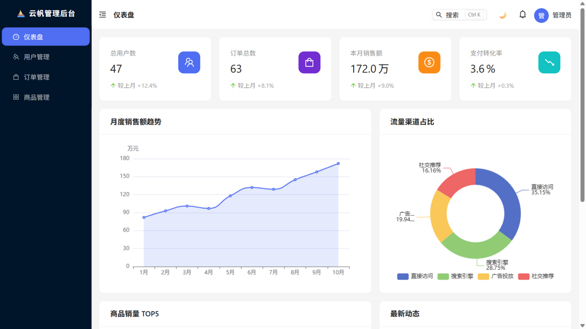
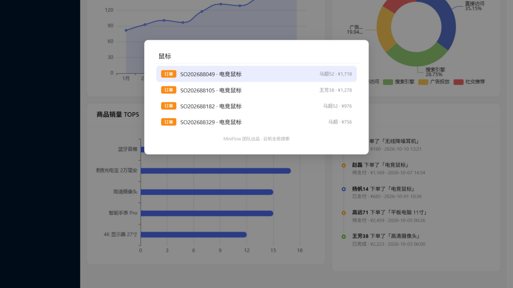
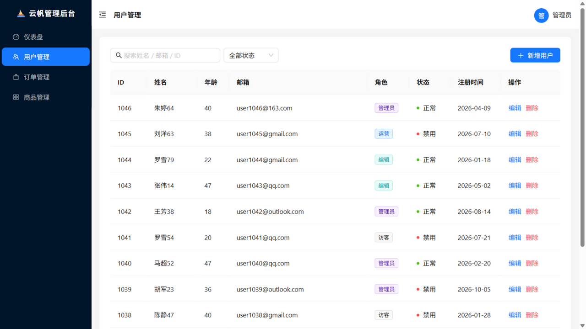
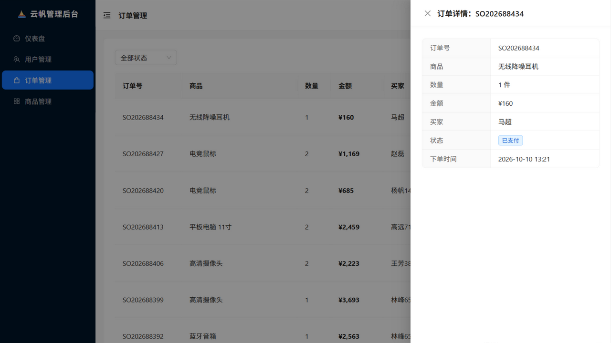
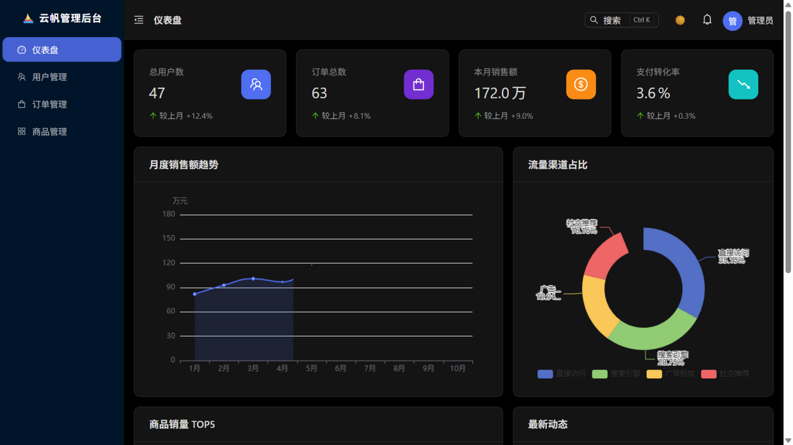
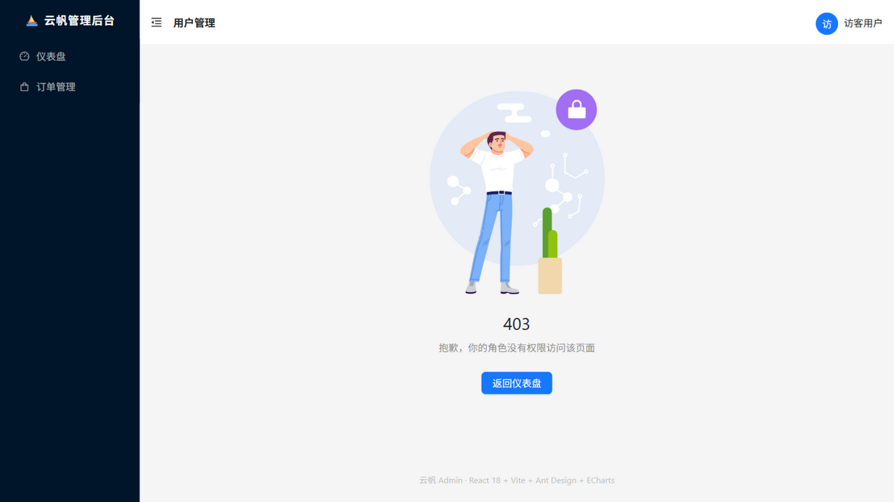

<div align="center">

# ⛵ 云帆 Admin

**一个用 React 18 + TypeScript 从零实现的中后台管理系统**

JWT 鉴权 · 服务端分页 CRUD · 三级权限 · ⌘K 命令面板 · 暗色模式 · 数据可视化 · 前后端一体部署

[](https://react.dev)
[](https://www.typescriptlang.org)
[](https://vitejs.dev)
[](https://ant.design)
[](https://echarts.apache.org)
[](https://yunfan-admin.vercel.app)

</div>



## ✨ 特性

- 🔐 **JWT 登录鉴权** —— axios 拦截器自动携带 token、401 统一回收登录态、路由守卫 + 登录后回跳
- 🛡️ **三级权限体系** —— 菜单权限 / 路由权限（403 页）/ 按钮权限，权限点收敛在 `src/access.ts`（参考 ant-design-pro 的 access 模式）
- 🎨 **暗色模式** —— antd algorithm 全局切换，主题偏好持久化
- ⌨️ **⌘K 命令面板** —— 全局搜索页面 / 用户 / 订单，键盘 ↑↓ 导航、回车跳转
- 📊 **数据可视化** —— ECharts 按需引入（自封装渲染组件，图表包体 -51%），销量排行 / 趋势 / 渠道占比
- 🚀 **路由级代码分割** —— 每个页面独立 chunk，echarts(531KB) 仅在仪表盘路由加载
- 🧱 **前后端一体部署** —— 开发环境 json-server，生产环境 Vercel Serverless Functions，接口层零改动切换
- 📱 响应式布局、页面切换动画、骨架屏、CSV 导出、消息通知中心

## 🖼️ 界面预览

| 登录 | 命令面板 |
|---|---|
|  |  |

| 用户管理 | 订单管理 |
|---|---|
|  |  |

| 暗色模式 | 无权限访问 |
|---|---|
|  |  |

## 🚀 快速开始

```bash
git clone https://github.com/wjh941/yunfan-admin.git
cd yunfan-admin
npm install

# 终端 1：本地 API（端口 3001）
npm run api

# 终端 2：前端（端口 5173）
npm run dev
```

**演示账号**：`admin / 123456`（管理员）· `guest / 123456`（只读访客）

其他命令：

```bash
npm run build        # tsc 类型检查 + 生产构建
npm run typecheck    # 仅类型检查
npm run preview      # 预览生产构建
node scripts/gen-db.mjs  # 重置本地数据库
```

## 🧱 工程亮点

| 实践 | 说明 | 效果 |
|---|---|---|
| axios 二次封装 | 实例化 + 请求/响应拦截器，token 注入、401 回收、错误统一包装 | 页面层零错误处理样板 |
| 自封装 EChart 组件 | echarts-for-react 内部全量引入 echarts，按需加载失效；自封装 30 行组件 + echarts/core 注册 | 图表包体 1052KB → 513KB |
| manualChunks 函数式分包 | 只对零依赖叶子库（echarts）手动分 chunk，避免 chunk 间循环初始化 | 白屏事故排查与修复，见下文踩坑 |
| 路由级代码分割 | React.lazy + Suspense，每页独立 chunk（1~29KB） | 非仪表盘路由不加载 echarts |
| 接口层抽象 | 页面只调 api 函数，Mock → json-server → Serverless 三次切换页面代码零改动 | — |
| tsc 构建门禁 | `tsc --noEmit && vite build`，类型错误在部署前拦截 | — |

## 🕳️ 踩坑记录（真实调试痕迹）

1. **manualChunks 循环引用白屏**：函数式分包把路径含 "react" 的模块（如 rc-util 的 `React/` 目录）错分进 react chunk，而它们又依赖 antd，形成 chunk 间循环引用，antd 在 React 初始化前执行导致线上白屏（`Cannot read properties of undefined (reading 'createContext')`）。**修复**：只对零依赖叶子库手动分包，其余交给默认策略。
2. **Node ESM 相对导入必须带扩展名**：`"type": "module"` 下 `from './_db'` 部署后直接 500。
3. **json-server 中间件**：`"type": "module"` 项目里要用 `.cjs` 后缀；bodyParser 先于自定义中间件执行，手动读流会让请求挂起。
4. **echarts-for-react 按需加载失效**：它内部 `import * as echarts from 'echarts'`（全量），按需引入被整个抵消。
5. **接口层抽象的回报**：Mock → json-server → Serverless 三次切换，页面代码零改动。

## 📁 目录结构

```
├── api/                        # Vercel Serverless 函数（生产后端）
│   ├── _db.js                  #   内存数据库 + 分页工具
│   ├── login.js / users.js / orders.js / products.js ...
├── server/
│   ├── auth-middleware.cjs     # json-server 登录中间件（开发后端）
│   └── db.json                 # 本地数据库（可写）
├── scripts/gen-db.mjs          # 数据库生成/同步脚本
└── src/
    ├── access.ts               # 权限收敛模块（参考 ant-design-pro）
    ├── api/                    # request.ts(axios封装) + index.ts(接口函数)
    ├── components/             # EChart / CommandPalette / NotificationBell / PageLoading
    ├── constants/              # 状态字典
    ├── context/                # AuthContext / ThemeContext
    ├── hooks/                  # useLocalStorage
    ├── layouts/                # 后台骨架
    ├── pages/                  # Login / Dashboard / Users / Orders / Products / Forbidden
    ├── types/                  # 全局业务类型
    └── utils/                  # echarts 按需注册
```

## 🗺️ Roadmap

- [ ] React Query 替代手写请求状态（缓存 / 重试 / 失效管理）
- [ ] 路由懒加载粒度细化 + 预加载策略
- [ ] RBAC 权限配置化（权限点由后端下发）
- [ ] Vitest 单元测试覆盖接口层与权限模块

## 📄 License

[MIT](LICENSE)
